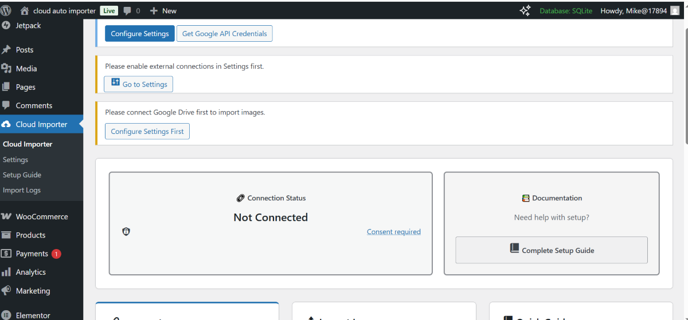
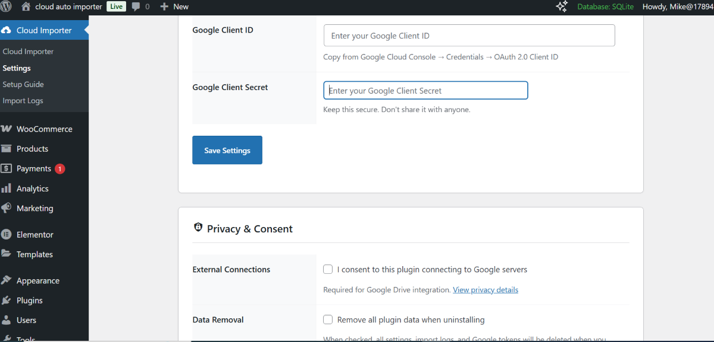
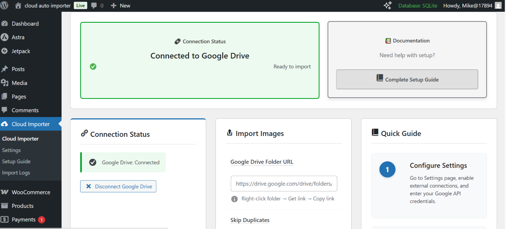

# Michael Cloud Image Auto Importer

Import images from Google Drive into your WordPress Media Library using a
WordPress plugin designed to simplify image management.

## Overview

Michael Cloud Image Auto Importer helps website owners reduce manual image
uploads by connecting a Google Drive folder to their WordPress workflow.

The plugin is intended for WordPress sites, including WooCommerce stores
where the relevant integration is supported.

## Features

- Import images from a Google Drive folder.
- Integrate with the WordPress Media Library.
- Support batch image-import workflows.
- Detect duplicate images where supported by the configured workflow.
- Generate alt text from filenames.
- Support image optimization and WebP workflows where configured.
- Provide import status and error handling through the plugin interface.

See the current plugin documentation and settings for the exact features
available in each released version.

## Screenshots

The screenshots below are included in this repository.

### Plugin interface

### Import workflow

### Additional interface

## Requirements

- A working WordPress installation.
- A PHP version supported by your installed WordPress version and this
  plugin release.
- Google Drive access and the required authorization configuration.
- A writable WordPress uploads directory and sufficient server resources.

Check `trunk/readme.txt` and the plugin header for the supported versions
before deploying to production. Do not assume compatibility with every
WordPress or PHP version.

## Installation

1. Download the plugin ZIP from the repository's Releases page, if a
   packaged release is available.
2. In WordPress, open **Plugins → Add New Plugin → Upload Plugin**.
3. Select the ZIP file and click **Install Now**.
4. Activate the plugin.
5. Open its settings and follow the documented Google Drive authorization
   process.

Alternatively, install a packaged plugin through the WordPress admin
interface or copy the plugin directory into `wp-content/plugins/`.

Do not upload the entire Git repository as a plugin ZIP unless it has
been packaged in the format WordPress expects.

## How to use

1. Install and activate the plugin.
2. Configure Google Drive authorization using the instructions supplied
   with the plugin.
3. Provide the Google Drive folder link in the plugin interface.
4. Start the import using the available controls.
5. Review the import status and check the WordPress Media Library.
6. Verify the imported images, filenames, alt text, and optimization
   results.

Exact controls and authorization steps depend on the installed release.

## Architecture

The repository's plugin source is organized around these components:

- `trunk/cloud-auto-importer.php` — main plugin entry point.
- `trunk/includes/class-admin.php` — administrative interface and related
  operations.
- `trunk/includes/class-google-drive.php` — Google Drive integration.
- `trunk/includes/class-importer-core.php` — core import processing.
- `trunk/assets/` — administrative CSS and JavaScript.
- `trunk/readme.txt` — WordPress.org plugin documentation.

The plugin uses PHP for its WordPress integration and JavaScript/CSS for
the administrative interface. Where configured, the Google Drive
authorization and file-transfer workflow also uses a Cloudflare Worker.

## Testing

See [TESTING.md](TESTING.md) for the manual regression checklist.

PHP syntax checks and WordPress integration tests must be run in a suitable
PHP and WordPress environment. This README does not imply that automated
tests have passed.

## Security

- Never commit service-account keys, OAuth client secrets, access tokens,
  or production credentials.
- Use least-privilege authorization for Google Drive access.
- Test imports using a disposable WordPress site before production use.
- Keep WordPress, PHP, and related dependencies updated.

## Repository structure

- `trunk/` — current plugin development source.
- `tags/` — versioned plugin releases.
- `assets/` — repository images and screenshots.
- `TESTING.md` — testing and regression checklist.

## Links

- **GitHub:** https://github.com/MIKE2634/michael-cloud-image-auto-importer
- **Developer portfolio:** https://mike2634.github.io/portfolio/

## Contributing

Bug reports, reproducible issues, and focused improvements are welcome.
Please describe the steps to reproduce a problem and include relevant
error messages without exposing credentials or personal data.

## License

Refer to the plugin's licensing information in its source files and
WordPress.org documentation.
